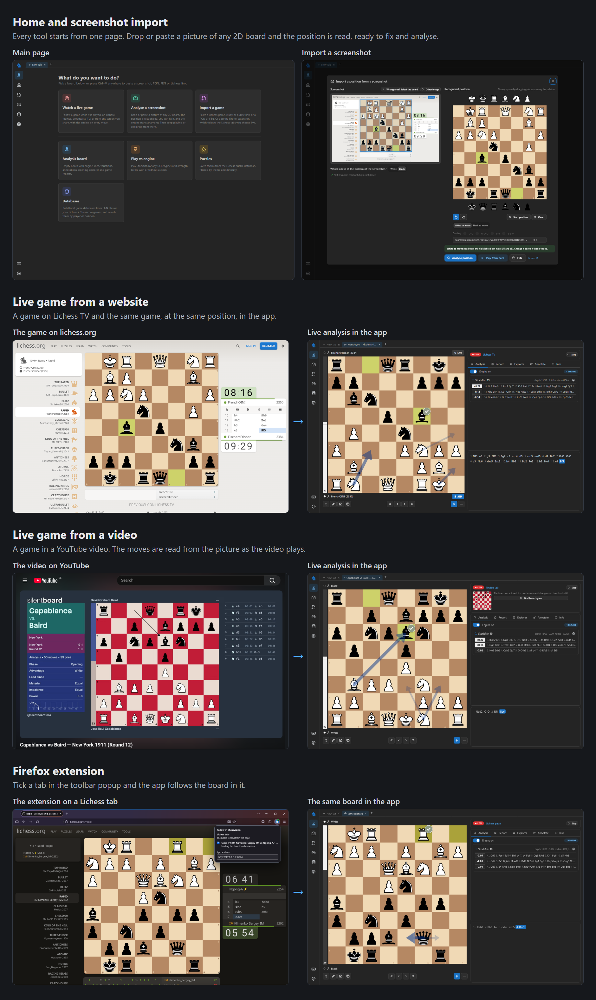
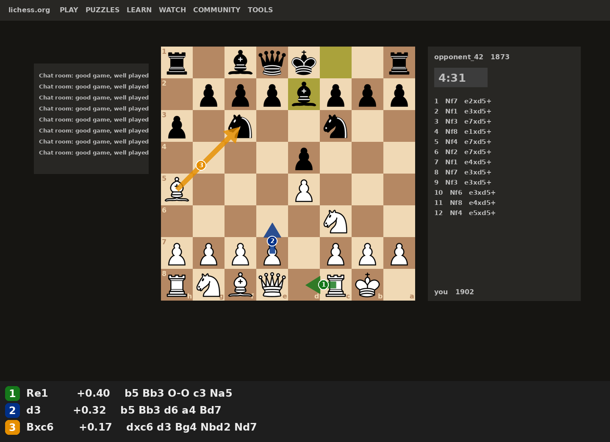

# chess-board-vision

A local chess analysis app that follows games while they are played. Point it at a live game
on a website such as Lichess or Chess.com, or at a stream or video on Twitch or YouTube, and
Stockfish analyses and classifies every move as it arrives.

It also has these tools ([details](#analysis-ui)):

* **Screenshot import:** read a position from a picture of any 2D board, then analyse or play from it.
* **Analysis board:** engine lines, variations, annotations and PGN/FEN import and export.
* **Game report:** accuracy, mistakes and blunders, and an evaluation graph for a whole game.
* **Opening explorer:** Lichess masters and players, and your own databases.
* **Play vs engine:** 8 strength levels, with or without a clock.
* **Puzzles:** tactics from Lichess, filtered by theme and difficulty.
* **Databases:** import PGN files or your Lichess and Chess.com games, and search them.
* **Firefox extension:** choose a browser tab and the app follows the board in it.
* **[Command line](#command-line):** turn a screenshot into a FEN and the engine's top moves.



## Download

**The app.** You need Python and Node 18+. There is no installer: clone the repository and
build the interface once.

```bash
git clone https://github.com/Ahmed-AlGhosaini/chess-board-vision.git
cd chess-board-vision
pip install -r requirements.txt
cd ui && npm install && npm run build && cd ..
python app.py                                     # opens http://127.0.0.1:8765
```

**The engine.** Stockfish is not included. On Windows, [download it](https://stockfishchess.org/download/)
and extract it into `engine/`, so that the program is at
`engine/stockfish/stockfish-windows-x86-64-universal.exe`; the app finds it there. For any other
system or build, put it on your PATH as `stockfish` or set `STOCKFISH_PATH`. Other UCI engines
can be added in the app.

**The Firefox extension (optional).** It is in `firefox-extension/`. In Firefox, open
`about:debugging#/runtime/this-firefox`, choose **Load Temporary Add-on** and pick
`firefox-extension/manifest.json`. Firefox removes it when it closes; [Firefox extension](#firefox-extension)
explains how to keep it.

## Command line

Screenshot of a 2D chessboard → board located → pieces recognised → FEN →
Stockfish's top 3 moves → numbered arrows drawn back onto the image.

```
python analyze.py examples/screenshot.png
```



```
board at x=380 y=110, size 600x600px

r . b q k . . r
. p p p b p p p
p . n . . n . .
. . . . p . . .
B . . . P . . .
. . . . . N . .
P P P P . P P P
R N B Q . R K .

FEN:      r1bqk2r/1pppbppp/p1n2n2/4p3/B3P3/5N2/PPPP1PPP/RNBQ1RK1 w kq - 0 1
Lichess:  https://lichess.org/analysis/standard/r1bqk2r/...
View:     white at the bottom (auto-detected)

Stockfish, depth 18 (eval from White's side):
1. Re1        +0.40   Re1 b5 Bb3 O-O c3 Na5 Bc2 d5
2. d3         +0.32   d3 b5 Bb3 d6 a4 Bd7 c3 Na5
3. Bxc6       +0.17   Bxc6 dxc6 d3 Bg4 Nbd2 Nd7 Nc4 f6
```

## Analysis UI

A local chess GUI in the style of [En Croissant](https://github.com/franciscoBSalgueiro/en-croissant),
with screenshot import built in: drop or paste (Ctrl+V) a picture of a board, fix any
misread square, check the side to move (read from the highlighted last move when the
board shows one), and the engine starts analysing. From there you
can keep playing moves and analysing variations, or play the engine from that position.
See [Download](#download) to install and start it. To stop a server left running on Windows:

```bash
Get-NetTCPConnection -LocalPort 8765 -State Listen | ForEach-Object { Stop-Process -Id $_.OwningProcess }
```

| Area | What it does |
|---|---|
| Boards | Tabs; analysis board with variations, NAGs, comments, drawn arrows; PGN/FEN import & export; board editor; keyboard and mouse-wheel navigation |
| Screenshot import | Board found and read by the pipeline below; uncertain squares outlined; manual box selection if detection fails; orientation; side to move read from the last-move highlight, or picked by hand when there is none; then analyse or play |
| Engine | Live MultiPV analysis over a websocket, eval bar, best-move arrows, hover previews, click a line to play it; several UCI engines side by side; a badge on the moved piece classifies the move, from brilliant to blunder (can be turned off in Settings) |
| Live games | Follow a game as it is played (Lichess game / broadcast / TV, or any shared screen); engine on the newest move, every move classified as it arrives ([details](#live-games)) |
| Report | Whole-game analysis: accuracy, ACPL, inaccuracies/mistakes/blunders annotated, best lines added, clickable eval graph |
| Explorer | Lichess masters / players explorer (needs a [Lichess token](#lichess-api-token-optional)) and your local databases |
| Play | Against any engine at 8 levels, with clocks, takeback and resign; or two players on one board |
| Puzzles | From the Lichess puzzle API, filtered by theme and difficulty, with hints |
| Databases | SQLite per database: import PGN files, download Lichess / Chess.com games, search, position index for the explorer |
| Engines / Settings | Add UCI engines and edit their options; board and piece themes (Lichess sets), sounds, notation, light/dark |

### Live games

**Watch a live game** (new-tab page or sidebar) follows a game while it is being played. The
engine panel follows the newest move, and every move is evaluated as it arrives, so
inaccuracies, mistakes and blunders are marked in the move list and the Report panel shows
running accuracy and an eval graph. You can step back through the game or try variations at
any time; **Jump to live** returns to the newest move.

| Source | How |
|---|---|
| Lichess game | Paste a game link (`lichess.org/abcd1234`). The server reads Lichess's game stream; moves and clocks are exact. |
| Lichess broadcast | Paste a broadcast round (or tournament) link and pick one of its games. |
| Lichess TV | Top rated, blitz, rapid or classical; moves on to the channel's next game when one ends. |
| Screen capture | Share a window or tab showing a 2D board (a Twitch/YouTube stream, Chess.com, any app). The board is found as in screenshot import, then read each time it changes and settles; the moves are found by matching the picture against the legal moves (two plies, if a frame was missed). |
| Firefox extension | Follows the board in the Firefox tabs you choose, with one chessvision tab per Firefox tab. Lichess tabs (games, TV, analysis, studies, broadcasts, puzzles) are read directly, other tabs from a picture as in screen capture: see below. |

Lichess shows other people's games with a short delay, and broadcasts arrive as fast as the
tournament relays them. Screen capture has the same limits as screenshots (2D boards seen
straight on). If the board moves on screen, use **Find board again**. If moves were missed or a
new game started, the tab shows *Lost track* and offers to restart from the position on
screen. The per-move depth is set in **Settings → Analysis → Live game depth**.

### Firefox extension

`firefox-extension/` sends nothing until you choose a tab: its toolbar button lists your open
tabs, and each tab you tick is followed from then on. A tab stays chosen until you untick or close
it; a browser restart clears all choices. **Stop** on a live tab stops following it. The toolbar
button also shows each chosen tab's status and sets the app's address, if you start it with another
`--port`.

**Lichess tabs** are read directly from the page, also in the background. The main board is sent
whether moves are played or stepped through, and following carries on when the tab moves to another
game. Small preview boards (game lists, the home page) are ignored, and so is a game you are
playing yourself until it ends, as engine help during your own game is against Lichess's rules.

**Other tabs** (Chess.com, a Twitch or YouTube stream) are sent as pictures, twice a second when
they change, to the app on this computer and nowhere else. Choosing one opens the screen capture
dialog in the app without asking to share the screen: check the position there and start watching.
The limits of screen capture apply (2D boards seen straight on), and it cannot tell that a game is
your own, so do not use it on games you are playing. **In a background tab, Firefox freezes videos**
after a few seconds and some pages stop redrawing: keep such a tab visible, in its own window if
need be. Taking pictures of any site is why the extension asks for access to all websites; only
tabs you tick are ever captured.

To try it, open `about:debugging#/runtime/this-firefox`, choose **Load Temporary Add-on** and
pick `firefox-extension/manifest.json`. Firefox removes it again when it closes. To keep it, sign it
for yourself with a free [addons.mozilla.org API key](https://addons.mozilla.org/developers/addon/api/key/):
it stays private to you, and Firefox opens the resulting `.xpi` to install it.

```bash
npx web-ext sign --source-dir firefox-extension --artifacts-dir firefox-extension/dist \
  --channel unlisted --api-key YOUR_JWT_ISSUER --api-secret YOUR_JWT_SECRET
```

### Lichess API token (optional)

Everything runs locally except a few features that talk to Lichess. Only one of them
needs a token:

| Feature | Token needed? |
|---|---|
| Screenshot import, analysis, game report, play vs engine, local databases | No (all local) |
| Live games (Lichess games, broadcasts, TV; screen capture is local) | No |
| Puzzles | No |
| Downloading your Lichess games | No (a token raises the rate limit) |
| Downloading Chess.com games | No (does not use Lichess) |
| Explorer: Lichess Masters / Lichess players | **Yes**, Lichess rejects anonymous explorer requests |

To use the online explorer, create a token at <https://lichess.org/account/oauth/token>
(no scopes needed) and paste it in **Settings → Lichess**. It is stored in your browser
and sent only to the local server, which forwards it to Lichess. Without a token, the
explorer still works on your local databases.

`server/` is the FastAPI backend; `ui/` is React + Mantine + chessground + chessops.
For frontend development run `python app.py --no-browser` and `npm run dev` in `ui/`.
User data (engines, databases, piece cache) lives in `data/`.

## Pipeline

```
screenshot ──► 1. find board ──► 2. classify 64 squares ──► 3. build position ──► 4. Stockfish MultiPV ──► 5. draw arrows
               (classical CV)     (tiny CNN, NumPy)          (python-chess)
```

| Stage | Module | How |
|---|---|---|
| 1. Find the board | `board_detect.py` | No learning. On an interior grid line of a checkerboard the brightness flips light→dark on one square and dark→light on the next, so the gradient across that line has *both* signs. Per column/row we score `sqrt(Σ(+∂I) · Σ(−∂I))`, pick the 7 equally spaced peaks, refine them with a least-squares fit, then re-run each axis restricted to the other's span to drop UI clutter. Works with any theme, sub-pixel accurate, down to ~10 px per square. |
| 2. Read the squares | `model.py`, `synth.py`, `train.py` | A 73k-parameter CNN (3 × [conv-conv-pool], 32×32 RGB in, 13 classes out). Trained only on **synthetic** boards: 32 Lichess piece sets on random themes, with last-move/check/selection highlights, move dots, in-board coordinates, wood-like textures, JPEG and blur, and ±5 % crop jitter so it tolerates imperfect localisation. BatchNorm is folded into the convs on export, and inference is plain NumPy (~0.1 s per board), so running the tool needs no ML framework. |
| 3. Build the position | `recognize.py` | Grid → `chess.Board`. Orientation is guessed from where White's army sits (pawns count double); castling rights come from kings/rooks on their home squares; `board.status()` catches impossible positions; squares below 80 % confidence are listed. |
| 4. Analyse | `engine.py` | Stockfish over UCI with MultiPV 3. Lines are taken from the deepest iteration in which all three finished, so the ranking is consistent (a time-limited search otherwise mixes depths). |
| 5. Draw | `draw.py` | Anti-aliased arrows in Lichess brush colours (green/blue/orange = 1st/2nd/3rd), number badges that dodge each other, and a legend with evals and lines. |

The side to move is read from the last-move highlight that most sites draw
(`highlight.py`): the two squares whose background differs from the other light or
dark squares are the last move, and the piece now on one of them shows who played
it. Without a highlight White is assumed; pass `--turn b` / `--turn w` to override.
En-passant rights are never set.

## Results

| | per square | whole board correct |
|---|---|---|
| Validation (32 training piece sets, new random boards) | 99.95 % | 98.3 % |
| Held-out piece sets never seen in training (`tatiana`, `maestro`) | 99.98 % | 99.3 % |
| End-to-end on 4 Lichess-style screenshots (dark/light page, flipped, JPEG, cropped) | | 4 / 4 |

Remaining validation errors come mostly from the more stylised sets
(`pirouetti`, `staunty`); typical confusions are bishop↔king and queen↔king.
The screenshots above are rendered by `tools/make_test_screenshots.py`, so try
it on your own real screenshots and use `--debug` to see each square's label.

## Setup

```bash
pip install -r requirements.txt          # numpy, opencv-python, pillow, chess
```

Install Stockfish from https://stockfishchess.org/download/ and either put it
on your PATH, set `STOCKFISH_PATH`, or pass `--engine C:\path\to\stockfish.exe`.

`models/squarenet.npz` is the trained model, so `analyze.py` works right away.

## Usage

```bash
python analyze.py shot.png                       # side to move and orientation auto
python analyze.py shot.png --turn b              # black to move
python analyze.py shot.png --orientation black   # force: black at the bottom
python analyze.py shot.png --bbox 380,110,600,600   # skip detection (x,y,w,h)
python analyze.py shot.png --time 5              # think longer (or --depth 22)
python analyze.py shot.png --fen-only            # just print the FEN + Lichess link
python analyze.py shot.png --debug               # save a crop with each square's label/confidence
```

## Training data

The data is synthetic, so it is generated rather than shipped. To get it
without training:

```bash
pip install numpy pillow resvg-py
python generate_data.py                          # -> data.npz, ~2 min, ~600 MB
python generate_data.py --png-dir squares/       # also a PNG per square: squares/<split>/<class>/
python generate_data.py --train-boards 200 --preview preview.png   # small sample + a contact sheet
```

The first run downloads ~34 Lichess piece sets into `assets/pieces/`.
Defaults (2,500 train + 300 val + 300 held-out boards, seed 0) are the
settings the shipped model was trained with. `data.npz` holds three splits
(`tr` train, `va` validation, `ho` held-out piece sets), each as
`X` (N,32,32,3) uint8 images, `y` labels indexing `classes`, and `s` the piece
set of every square. The PNG layout works with most image-classification
tools, e.g. torchvision's `ImageFolder`.

## Retraining

```bash
pip install -r requirements-train.txt            # adds jax, optax, resvg-py
python train.py --data-cache data.npz --out models/my_model.npz
python analyze.py shot.png --model models/my_model.npz
python train.py --train-boards 6000 --epochs 12 --holdout   # bigger run, nothing held out
```

`--data-cache` loads `data.npz` if it exists (e.g. from `generate_data.py`),
otherwise generates it and saves it there. Without `--out` the new model
replaces `models/squarenet.npz`.

The default run (2,500 boards = 160k squares, 8 epochs) took ~50 min on two
CPU cores; a laptop with more cores or a GPU is much faster. After training, the script checks that the NumPy runtime agrees with the JAX
model and prints the most common confusions and which piece sets cause them.

Regression test after changes:

```bash
python tools/make_test_screenshots.py test_screens
python tools/e2e_test.py test_screens path/to/stockfish
python tools/test_live_tracking.py               # live games: screen-capture move tracking, Lichess links
```

## Limitations and next steps

* **2D, axis-aligned digital boards only.** Photos of physical boards need a
  different localiser (corner/keypoint detection + homography) and real
  training images; the classifier and everything after it would carry over.
* **Side to move** is only known when the board highlights the last move; a
  bare diagram (book, puzzle, editor) still needs it picked by hand.
* **3D or unusual piece sets** outside the training mix may confuse the
  classifier. Add the set name to `DEFAULT_SETS` in `pieces.py` (or put your own
  PNGs in `assets/pieces/<name>/wK.png` …) and retrain.
* Piece sets are downloaded from the open-source Lichess repository
  (`lichess-org/lila/public/piece`) to your machine for training only; each set
  has its own licence, listed in lila's `COPYING.md`.

## Resources and credits

* **Piece sets (training data and UI).** The synthetic training boards are rendered
  from the piece sets in the open-source Lichess repository,
  [lichess-org/lila](https://github.com/lichess-org/lila/tree/master/public/piece).
  The UI's piece-set option downloads the same sets. Each set has its own licence,
  listed in lila's [`COPYING.md`](https://github.com/lichess-org/lila/blob/master/COPYING.md).
* **Sounds.** Move, capture and notification sounds are Lichess's "standard" set, downloaded
  from [lila](https://github.com/lichess-org/lila/tree/master/public/sound/standard) on first
  use and cached in `data/sounds/` (AGPL-3.0, see lila's `COPYING.md`). Offline, small
  synthesised sounds are used instead.
* **UI design.** The analysis UI is inspired by
  [En Croissant](https://github.com/franciscoBSalgueiro/en-croissant) by Francisco Salgueiro:
  its layout (sidebar, tabs, board with engine/report/explorer/annotation panels) and
  feature set served as the model.
* **Libraries.** [chessground](https://github.com/lichess-org/chessground) (the board,
  GPL-3.0) and [chessops](https://github.com/niklasf/chessops) from the Lichess project,
  [python-chess](https://github.com/niklasf/python-chess),
  [Mantine](https://mantine.dev), [Tabler Icons](https://tabler.io/icons),
  [Recharts](https://recharts.org) and [FastAPI](https://fastapi.tiangolo.com).
* **Engine.** [Stockfish](https://stockfishchess.org) (GPL-3.0).
* **Online data.** Puzzles, the opening explorer and game downloads use the
  [Lichess API](https://lichess.org/api) and the [Chess.com published-data API](https://www.chess.com/news/view/published-data-api).
